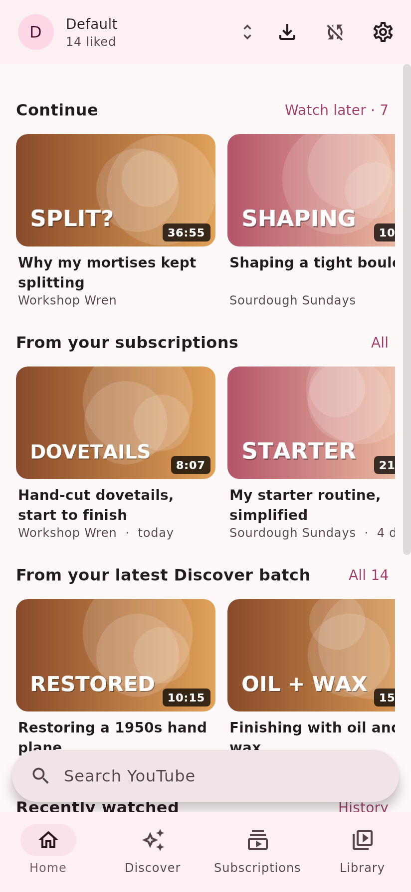
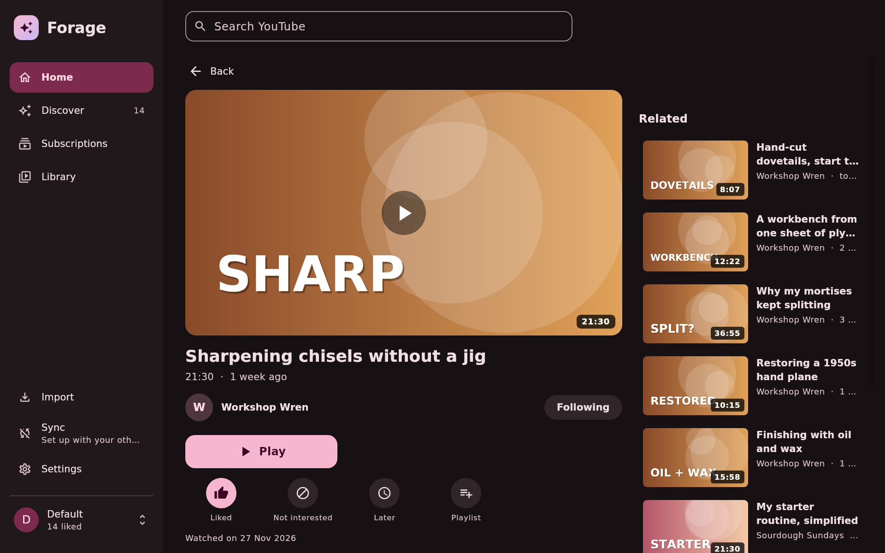
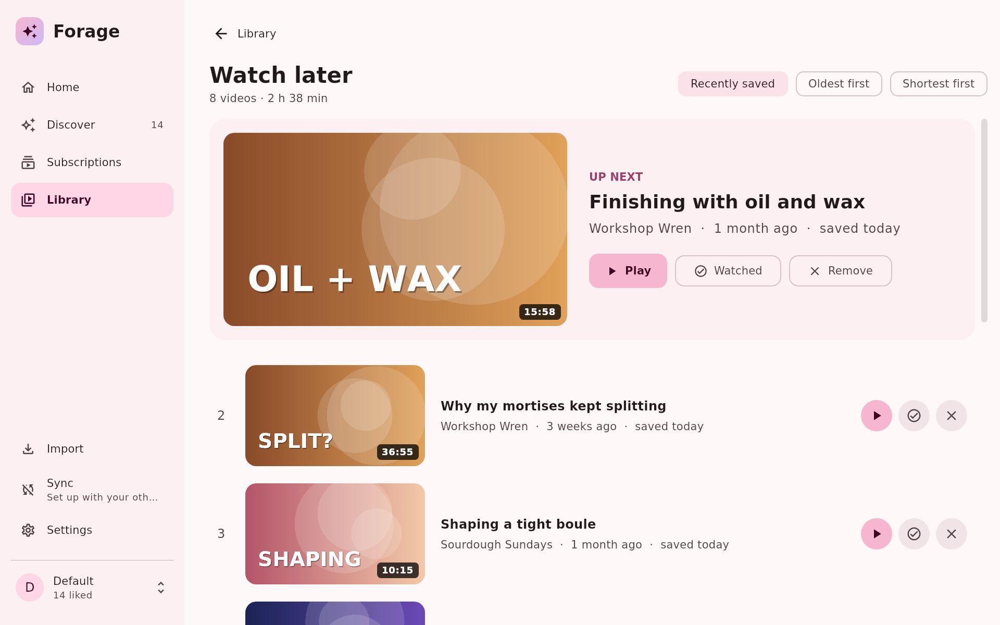

# Forage

**YouTube without an account, and without the feed.** Forage keeps your history, likes, playlists
and subscriptions on your own devices, and recommends new videos only when you ask: from what you
like, with the reason for each pick. No account, no server, no tracking.

<p>
  
  
</p>

## What it does

- **Recommendations when you ask.** Discover suggests videos from what you like, grouped by the
  topics your likes fall into, each with why it was picked. Nothing plays by itself and there's no
  endless feed. The model behind it runs on your device.
- **Your library, no account.** Watch history, likes, playlists, a watch-later queue,
  subscriptions with their new uploads, and where you left off in each video.
- **Bring your YouTube along.** Import from Google Takeout, or from NewPipe, FreeTube or LibreTube.
- **Play it your way.** On Android, videos play right in Forage, without ads. On Linux, in mpv
  (Forage sets it up in one click), FreeTube or your browser.
- **Sync without a server.** Pair your phone, tablet and computers over your home Wi-Fi, encrypted;
  your library stays the same on all of them.
- **A private vault.** A second library, encrypted and hidden until you unlock it with a PIN, kept
  apart from everything else.

<p>
  
  
</p>

## Install

Download the latest version from [Releases](https://github.com/janni0071/forage/releases).

**Android** (15 or newer, 64-bit ARM): download `forage-<version>.apk` on your phone and open it.
Android asks once to allow installing apps from your browser.

**Linux** (Debian, Ubuntu, Pop!_OS and others with `apt`, 64-bit): download
`forage_<version>_amd64.deb`, then open it with your software installer, or:

```bash
sudo apt install ./forage_<version>_amd64.deb
```

Forage then appears in your app menu. On first start it walks you through bringing your library
along and choosing a player.

## Updates

Forage can tell you when there's a new version: it offers this when you first start it, and
Settings, Backup & data, can switch it on or off. When allowed, it asks GitHub once a day and shows
a note with a download link; it never installs anything by itself.

On Android, [Obtainium](https://github.com/ImranR98/Obtainium) can also install and update Forage
straight from this repository's releases: add `https://github.com/janni0071/forage` in it.

## Privacy

Everything Forage knows lives on your devices. It has no account, no analytics and no server of
its own. It contacts only:

- **YouTube**, for what you ask for: searches, video details, your subscriptions' new uploads, and
  thumbnails. Playing in Forage on Android streams from YouTube too. No account is used.
- **Hugging Face**, once, to download the recommendation model (118 MB; on phones over Wi-Fi only,
  unless you say otherwise).
- **GitHub**, when you set up mpv (to download yt-dlp and Deno, and to keep yt-dlp up to date),
  and once a day if you allowed the update check.
- **Your own devices**, on your local network, when you pair them for sync.

The private vault's own site is contacted only while the vault is unlocked and you use it.

## Bring your library along

| From | How |
| --- | --- |
| Google Takeout | Forage's welcome walks you through it; import the zip Google emails you |
| NewPipe | Settings, Backup and restore, Export database; import the zip |
| FreeTube | Settings, Data settings: export subscriptions, history and playlists; import each file |
| LibreTube | Settings, Backup and restore, Backup; import the JSON file |
| Another device with Forage | Pair them (Settings, Sync) and the library comes over |
| A Forage backup | Settings, Backup & data, Restore from a backup |

## Build from source

Needs JDK 21. For the Linux package also `fakeroot`, for Android the Android SDK (`sdk.dir` in
`local.properties`, or `ANDROID_HOME`).

```bash
./gradlew test
```

```bash
./gradlew :desktop:packageDeb :android:assembleRelease
```

The package lands in `desktop/build/compose/binaries/main/deb/`, the APK in
`android/build/outputs/apk/release/`. Release APKs are signed with your own key when
`FORAGE_KEYSTORE` and `FORAGE_KEYSTORE_PASSWORD` are set, otherwise with the debug key. To run the
desktop app from source with its own data folder:

```bash
./gradlew :desktop:run --args="--data $HOME/forage-data"
```

The `cli` module does what the app does from a terminal (`./gradlew :cli:installDist`). The
design, and why it is the way it is, is in [docs/SPEC.md](docs/SPEC.md). The screenshots come from a
made-up library (`./gradlew :desktop:demoScreenshots`).

## Making a release

1. Set the new version in `gradle.properties` (`forage.version`); both apps take it from there.
2. Write what's new in `docs/releases/<version>.md`.
3. Merge to `main`, then tag and push: `git tag v<version>` and `git push origin v<version>`.

GitHub then runs the tests, builds the Linux package and the signed APK, and publishes the release
with those notes. It needs two repository secrets, `FORAGE_KEYSTORE_BASE64` (the signing key,
base64-encoded) and `FORAGE_KEYSTORE_PASSWORD`; without them, it stops rather than sign with
another key.

## Licence

GPL-3.0, as required by NewPipeExtractor.
